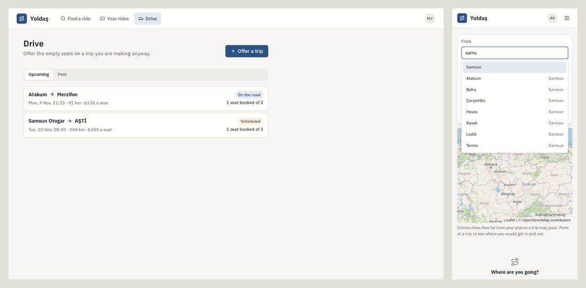
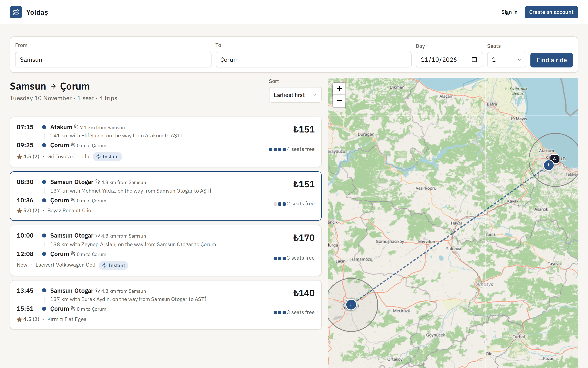
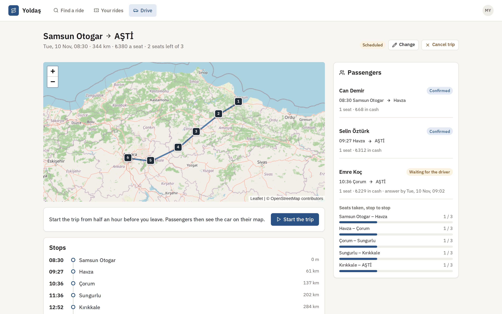
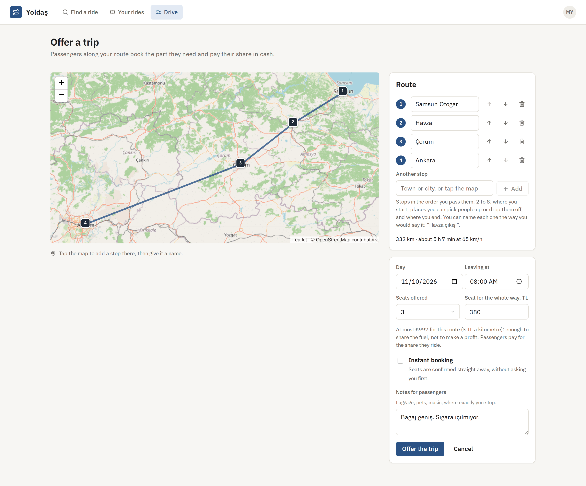
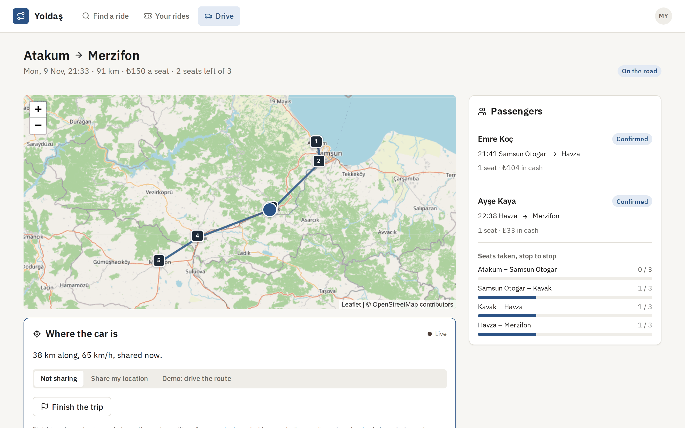
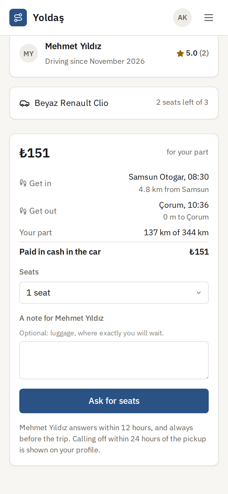
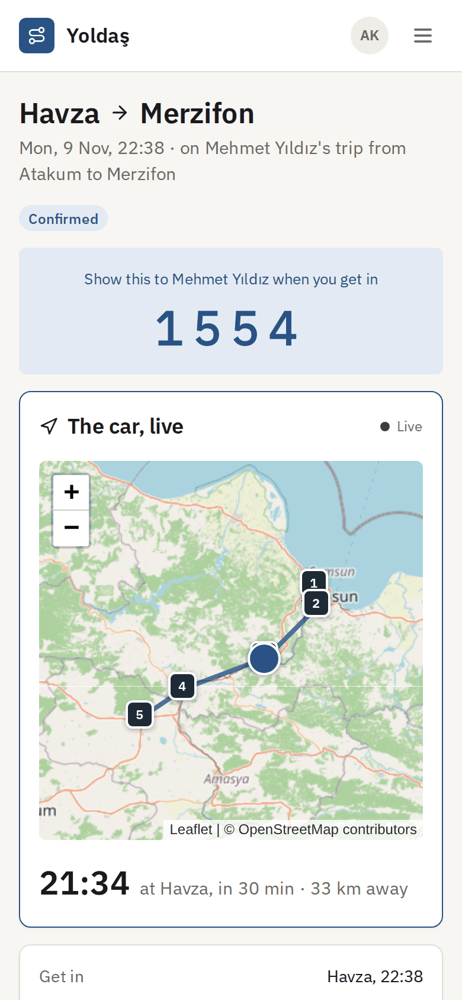
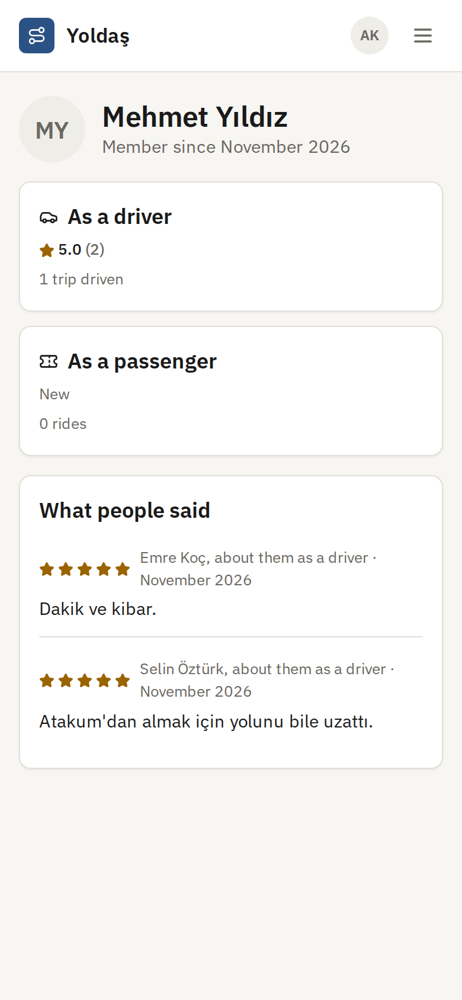
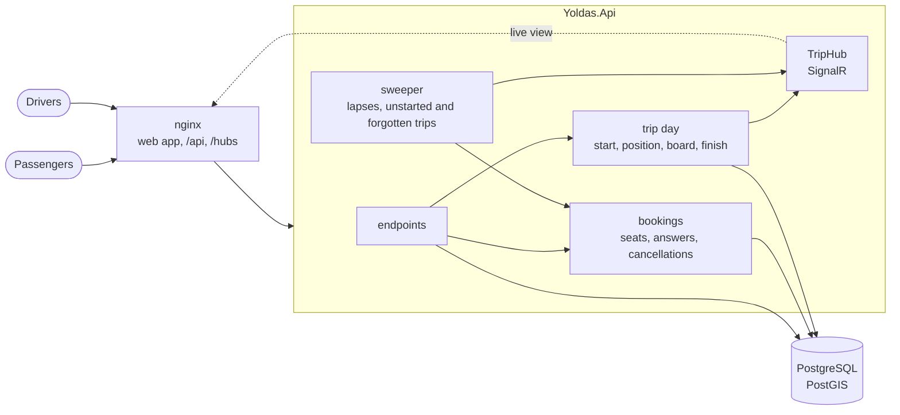
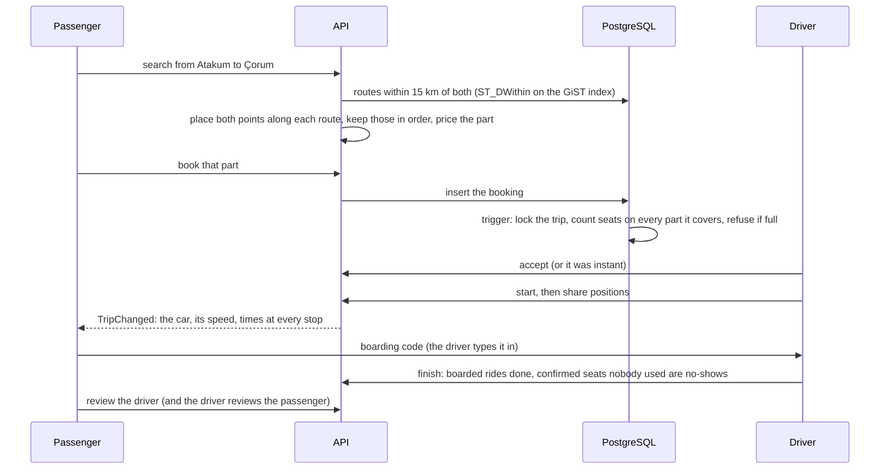

# Yoldaş

**English** · [Türkçe](README.tr.md)

Ride sharing that matches passengers along the driver's route. A driver going from Samsun to Ankara offers the empty seats and the stops they pass: Samsun Otogar, Havza, Çorum, AŞTİ. Someone in Atakum going to Çorum searches with their own two places and finds every trip that passes near both, in that order, with where they would get in and out, when the car passes there, and their share of the price. They pay for the part they ride, in cash in the car. On the day, the driver starts the trip and shares where the car is; passengers follow it on a map with the time it reaches their stop, and get in with a code from their screen. Both sides review each other afterwards.

Seats are counted per part of the route, so a seat someone leaves in Havza is free from Havza on, and two people can never take the last seat of a part at the same moment: a trigger in the database counts the seats on every part a booking covers before it is saved.

[](https://github.com/Beratoguzhan620/yoldas/actions/workflows/ci.yml)




## Try it

```bash
docker compose up --build
```

This starts PostgreSQL with PostGIS, the API and nginx with the web app. Open http://localhost:8080 and search without an account, or create one. Under *Drive*, add your car and offer a trip: type the towns you pass, or tap the map, and set the time and a price for a seat over the whole way. In a private window, create a second account, search from a place near the start to one further along, and book. To try the day itself, offer a trip leaving in a little over half an hour: it can be started from half an hour before, and *Demo: drive the route* moves the car along it, so you can follow it from the passenger's window.

- API reference: http://localhost:8080/scalar
- Places come from a built-in list of Turkey's 81 provincial centres and many towns, typed with or without Turkish letters (*corum* finds *Çorum*). No address is sent to an outside service.

## Features

- **Trips by stops:** 2 to 8 stops in the order the driver passes them, at least a kilometre apart, named the way the driver would say them (*Havza çıkışı*). The route is the straight legs between them; times along it assume 65 km/h. The route cannot change once offered, so nobody's booking is moved; the time, seats, price and notes can.
- **Search along the route:** a trip matches when its route passes within 15 km (up to 50) of where you start and where you are going, in that order, with enough seats free on that part. Each result says where you would get in and out, how far that is from your places, when the car passes there, and your price. Sort by departure, price or least walking.
- **A fair price by distance:** the driver sets a price for a seat over the whole route, at most 3 TL a kilometre: the point is to share the costs, not to earn a living. A passenger pays the share of the route they ride, to the nearest lira and never under 10 TL. Payment is in cash in the car; the app moves no money.
- **Seats per part of the route:** the driver sees how full the car is between each pair of stops. A seat booked from Samsun to Havza is free again from Havza to Ankara.
- **Requests and instant booking:** on an instant trip the seats are confirmed at once. Otherwise the driver answers within 12 hours, and always at least half an hour before the car reaches the passenger; a request nobody answers lapses. The plate is shown in full only to passengers whose seat is confirmed.
- **Cancellations with a record:** either side can call off a seat before the pickup, and the driver can cancel the whole trip, which calls off every seat. Within 24 hours of the pickup it is a late cancellation, shown on that person's profile. A trip the driver never starts is cancelled by the clock six hours after its departure, as the driver's late cancellation.
- **The day itself, live:** the driver starts the trip from half an hour before departure and shares where the car is from the phone's location (or the demo drive). Passengers with a confirmed seat follow it over SignalR: the car on the map, how far it has come, its speed, the expected time at every stop and at their own pickup, and a warning when it is off the route. When the trip finishes the car's position is cleared.
- **Getting in with a code:** the passenger's screen shows a four-digit code; the driver types it in. Five wrong codes replace it. A passenger who has not come can be marked a no-show once the car has passed their pickup, or fifteen minutes after its time.
- **Reviews both ways:** after a ride that took place, the passenger reviews the driver and the driver the passenger, once each, within two weeks. Profiles show a person's stars as a driver and as a passenger separately, with trips driven, rides, late cancellations and no-shows.

## Screenshots

| Search along the route | A trip, as its driver |
|---|---|
|  |  |
|  |  |

| The price for your part | Following the car | A driver's profile |
|---|---|---|
|  |  |  |

## Measured

`tests/load/load.mjs` runs a holiday rush against the full Compose stack on a standard GitHub Actions runner (4 cores), with the load client on the same machine. 40 drivers offer trips out of Samsun on three routes over the next three days, half of them instant, with 3 to 5 seats. 400 passengers then search, 64 at a time, from one place on a route to a later one, a few hundred metres from the stops, and book one of the first results for one or two seats. The drivers accept every waiting request at once, in random order. Afterwards the script works out, from every trip's passengers, how many seats are taken at every point of the route.

| Step | Result |
|---|---|
| The rush | 400 searches and bookings in 2.0 s: 290 saved, 23 told the seats had just gone, 87 found no trip for their day |
| Accepting at once | 226 acceptances in 0.4 s: 60 confirmed, 166 refused because the seats on that part had gone |
| Searching (a route-distance query and the seats free on each part) | p50 82 ms, p95 1.0 s |
| Booking (seats counted under a lock, for instant trips the seat itself) | p50 139 ms, p95 299 ms, p99 393 ms |
| Accepting | p50 58 ms, p95 92 ms |
| What must hold | 143 seats confirmed; no point of any route with more passengers than seats (the fullest cars exactly full); the load per leg the drivers see matching the confirmed seats; no server errors |

What the numbers say:

- Bookings and acceptances of one trip take turns behind a lock on the trip's row, taken by the seat trigger. They are short, so the line moves fast; trips do not wait on each other.
- Search is the heaviest call, and its tail grows with 64 at once on four cores: it filters routes with a spatial index, then places the two points along each candidate and counts the seats on that part. Numbers vary between runs on shared runners.

## Tech stack

- ASP.NET Core 10: minimal APIs, SignalR, a background sweeper, ProblemDetails, OpenAPI with Scalar, JWT bearer (also for the hub, from the query string on `/hubs` only), rate limiting
- PostgreSQL 17 with PostGIS: routes as geography line strings with a GiST index and `ST_DWithin`, PL/pgSQL triggers that count seats per part of the route under a row lock, a partial unique index, `xmin` as a concurrency token; Entity Framework Core 10 with Npgsql and NetTopologySuite
- React 18, TypeScript and Vite; the SignalR client; Leaflet with OpenStreetMap tiles; Lucide icons and IBM Plex; nginx with WebSocket forwarding
- xUnit, Testcontainers (PostGIS), the SignalR client in integration tests, Vitest, Playwright
- GitHub Actions: warnings as errors, .NET and web tests, pending-migration check, a browser walkthrough against the Compose stack
- Docker / Docker Compose

## Architecture



A seat, from the search to the review:



## Design decisions

- **Positions along the route, in metres.** Each stop is stored with how far along the route it is. A passenger's two places are projected onto the nearest point of the route, leg by leg on a local flat map, and kept as whole metres from the start. Every comparison after that (is the pickup before the drop-off, does this booking overlap that one, has the car passed the pickup) is a comparison of two integers.
- **The database counts the seats.** A trigger on bookings locks the trip's row and asks a SQL function for the most seats taken at any point of the new booking's span; if the car would be over full there, it raises a check violation that the API turns into "the seats have gone". A second trigger refuses lowering a trip's seats below what is booked on any part. The code checks first so most people are told early, but the triggers decide the races: in the tests twenty people take the last seat at the same moment and exactly one gets it, and raw inserts that skip the code are refused too.
- **Search in two steps.** PostGIS finds the routes that pass within the radius of both places, using a GiST index on the route lines. The order (pickup before drop-off), the price and the seats free on that part are then worked out in C# for those few routes, where they are easy to read and test.
- **Times stored in UTC, shown in Turkey's.** Departures are saved in UTC; a search for a day is the day in Turkey, turned into a UTC window. The web app shows every time in Istanbul's time zone wherever the browser is.
- **A live view anyone allowed can rebuild.** The trip row holds the last position, how far along it is, how far off the route and a speed blended from the last positions (between 15 and 130 km/h). A position never moves the car backwards along the route. The same view is sent over SignalR on every change and returned by `GET /live`, so a client that reconnects asks once and is up to date; the web app polls while the feed is down. Only the driver and passengers with a confirmed seat may follow; anyone else is told the trip does not exist.
- **Privacy on the road.** The car's position is kept only while the trip is under way and cleared when it finishes. The plate is masked until a seat is confirmed. Places are chosen from a built-in list of towns, so no address or search is sent to an outside geocoder.
- **The clock settles what people leave.** A sweeper lets unanswered requests lapse, cancels trips never started six hours after departure (a late cancellation by the driver), and finishes trips forgotten twelve hours after their arrival, counting boarded passengers as done and confirmed seats nobody used as no-shows. Every pass is safe to run twice and on several instances.

## Commands

| Command | What it does |
|---|---|
| `docker compose up --build` | The whole app on http://localhost:8080 |
| `dotnet test` | .NET unit and integration tests (Docker needed for Testcontainers) |
| `cd web && npm install && npm test` | Web app unit tests |
| `cd web && npm run dev` | The web app with hot reload on http://localhost:5173, against the API on port 5900 |
| `cd tests/e2e && npm install && node yoldas.mjs` | The browser walkthrough, against a stack started with `AUTH_ATTEMPTS_PER_MINUTE=1000` |
| `cd tests/e2e && node media.mjs` | Demo trips, finished rides and reviews, and the README screenshots |
| `node tests/load/load.mjs 400 40` | The load test, against a stack started with `AUTH_ATTEMPTS_PER_MINUTE=100000` |
| `dotnet ef migrations add <Name> --project src/Yoldas.Infrastructure --startup-project src/Yoldas.Api --output-dir Persistence/Migrations` | Add a migration |

Configuration for a local run, kept out of the repository:

```bash
dotnet user-secrets --project src/Yoldas.Api set "ConnectionStrings:Yoldas" "Host=localhost;Database=yoldas;Username=…;Password=…"
dotnet user-secrets --project src/Yoldas.Api set "Jwt:SigningKey" "<at least 32 characters>"
```

## Tests

85 tests and a run against the whole stack: 54 .NET unit tests, 26 integration tests that run the real API against PostgreSQL with PostGIS in Testcontainers (with a SignalR client for the live feed), 5 Vitest tests for the web app, and an 8-step Playwright walkthrough with three browsers, all in CI.

- **Routes and places:** lengths and stop positions, projecting points onto the route, points before the start and past the end, stops too close or too many, the price cap and the share of the price, and town names typed without Turkish letters.
- **Search:** trips passing near both places in order, the part priced to the lira, both ends needed, cancelled trips leaving the results, and sorting by departure, price or how close they pass.
- **Seats and bookings:** seats counted per part of the route, a seat left in Havza carrying someone else on, twenty people taking the last seat at once leaving exactly one in it, the database refusing raw inserts and shrinking a car below what is booked, accepting when the seats have gone, answers due before the pickup, lapsed requests, late cancellations by either side, and cancelling a trip calling off every seat.
- **The day:** starting only from half an hour before, positions never going backwards, off-route warnings and expected times, only the driver and confirmed passengers following the live feed, boarding codes with wrong tries, no-shows, finishing, the clock cancelling trips never started and finishing forgotten ones, reviews once per side, and profiles.
- **Web app (Vitest):** the share of the price like the server's, the 3 TL a kilometre cap, distances along a route, Turkey's clock and durations.
- **Browsers (CI):** a driver adding a car and offering a trip by typing towns; a passenger finding it, seeing their share and asking for a seat; accepting and the load per leg; two people taking the last seat at once; starting, driving the route and following the car live; boarding after a wrong code; finishing and reviewing; and the live feed and other people's rides staying private.

## Roadmap and known gaps

- Real roads: the route is straight legs between stops, so distances and times are a little short. A routing engine (OSRM) could draw the road and give better times.
- Messages between driver and passenger, and notifications through the [notification-service](https://github.com/Beratoguzhan620/notification-service) when a request arrives or the car is near.
- Payment in the app, for those who want it; today it is cash in the car and the app moves no money.
- Recurring trips (every weekday at 07:30) and women-only rides.
- The live feed sends the whole view on every position; for many passengers per trip, a smaller message would do.

## License

[MIT](LICENSE) · Berat Oğuzhan Turğut · [GitHub](https://github.com/Beratoguzhan620)
