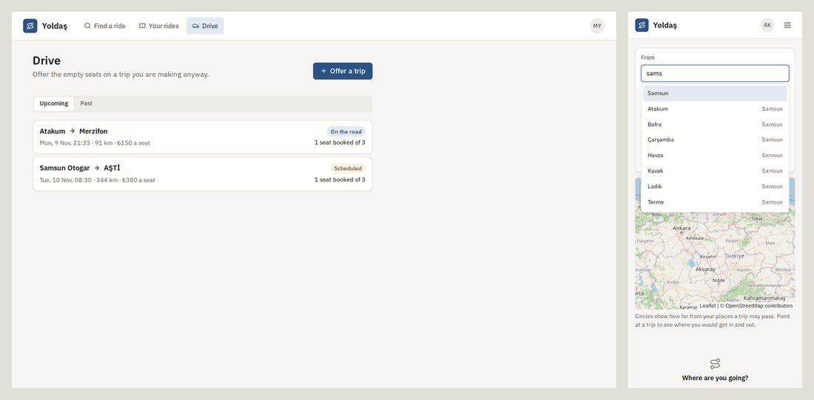
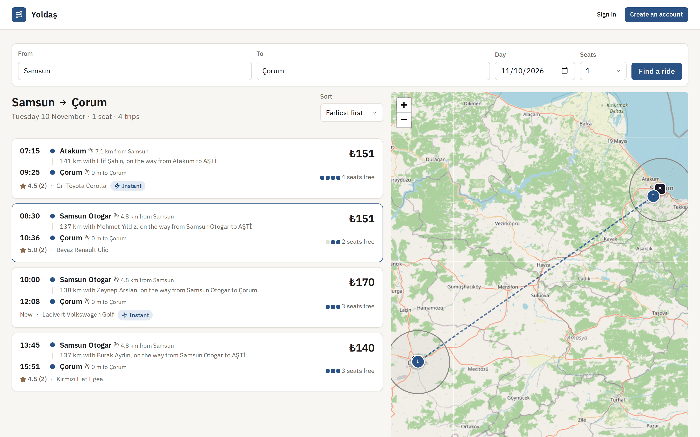
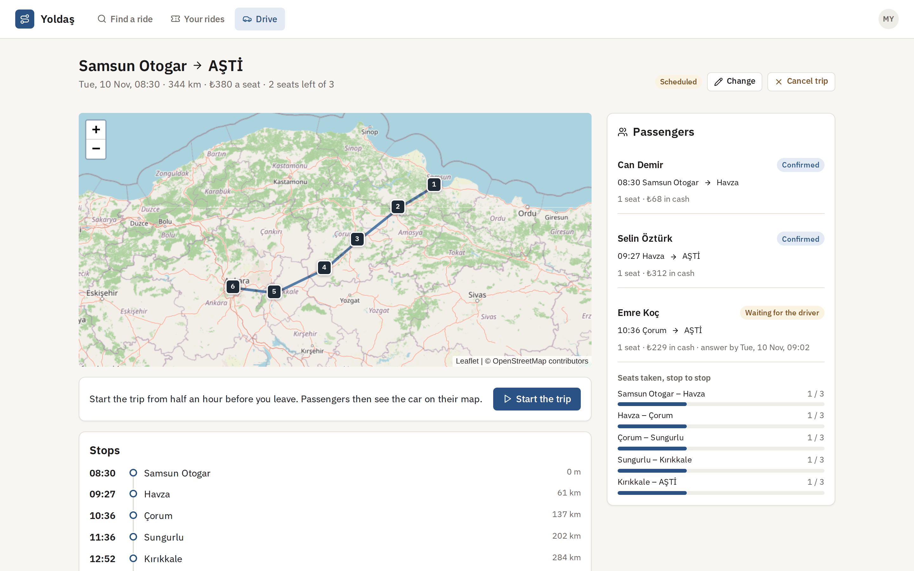
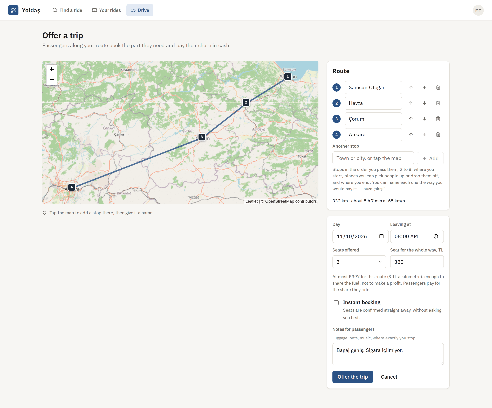
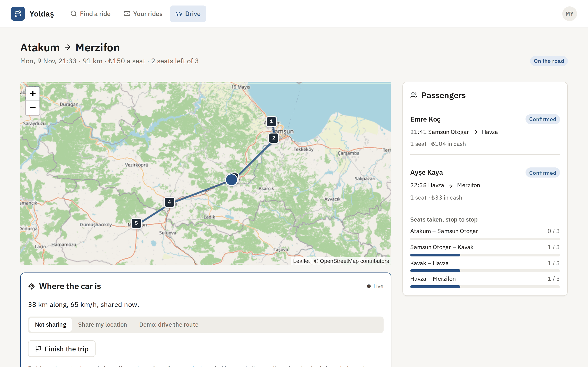
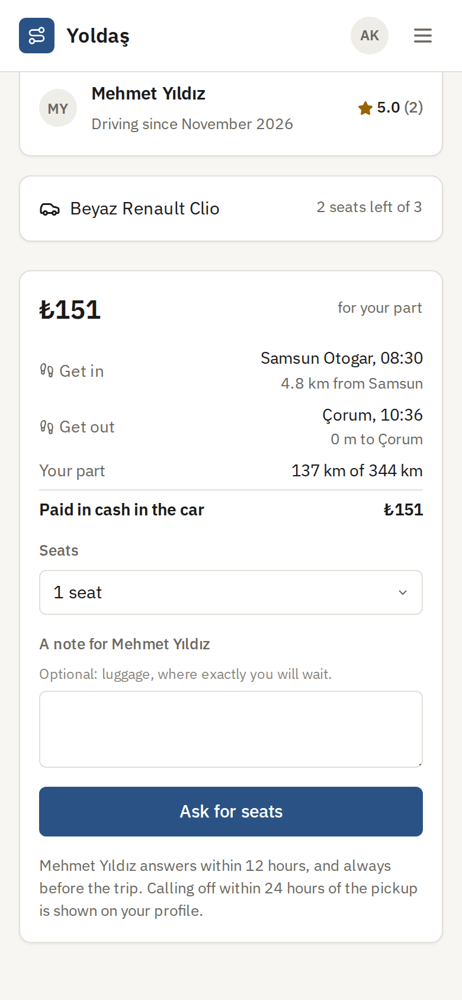
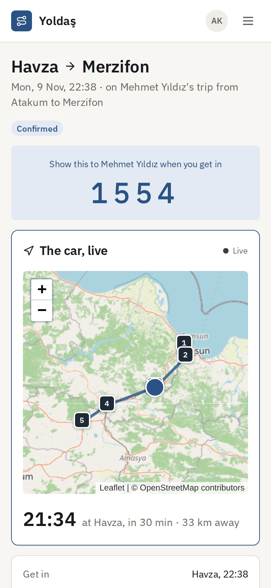
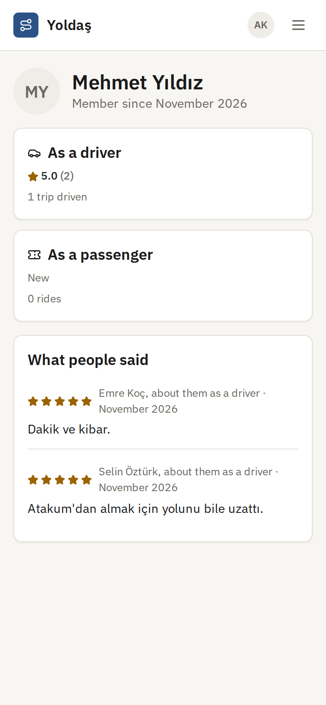
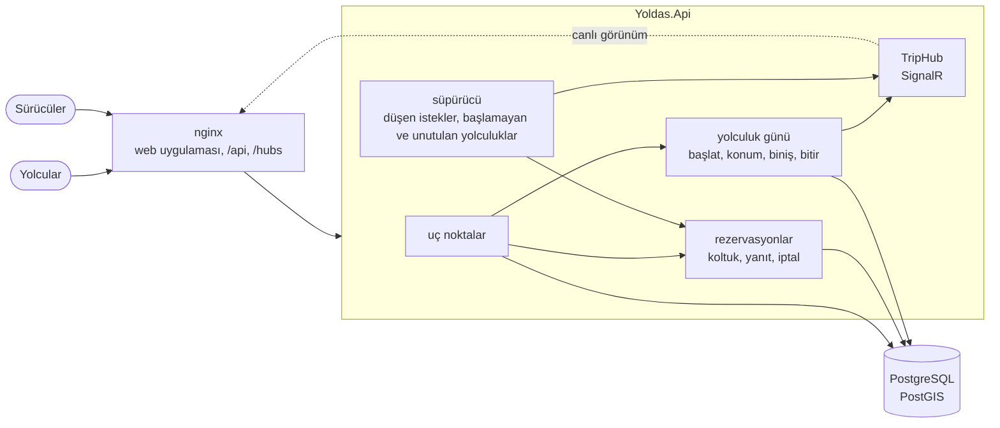
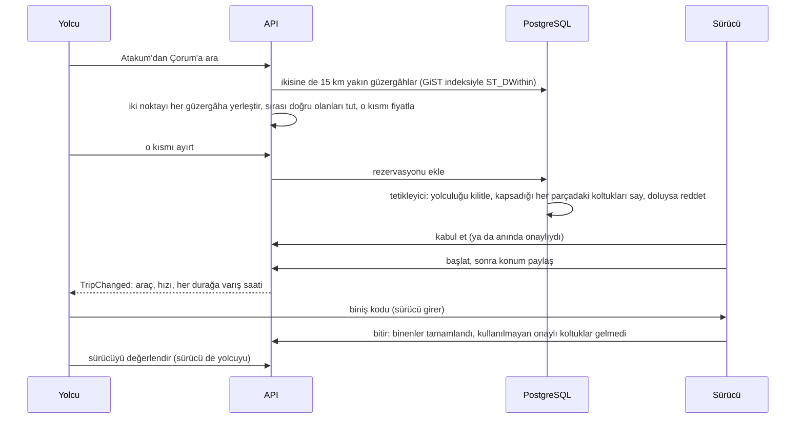

# Yoldaş

[English](README.md) · **Türkçe**

Yolcuları sürücünün güzergâhı üzerinde eşleştiren yolculuk paylaşımı. Samsun'dan Ankara'ya giden bir sürücü boş koltuklarını ve geçtiği durakları paylaşır: Samsun Otogar, Havza, Çorum, AŞTİ. Atakum'dan Çorum'a gidecek biri kendi iki noktasıyla arar ve ikisinin yakınından, bu sırayla geçen her yolculuğu bulur: nereden binip nerede ineceğini, aracın oradan ne zaman geçeceğini ve fiyattaki payını görür. Yolculuğun yalnızca kendi bindiği kısmının parasını, araçta nakit öder. Yolculuk günü sürücü yolculuğu başlatır ve aracın konumunu paylaşır; yolcular aracı haritada izler, durağına ne zaman varacağını görür ve ekranındaki kodla araca biner. Sonrasında iki taraf birbirini değerlendirir.

Koltuklar güzergâhın her parçası için ayrı sayılır: Havza'da inen birinin koltuğu Havza'dan sonrası için yeniden boştur. Aynı parçanın son koltuğunu iki kişi aynı anda alamaz: veritabanındaki bir tetikleyici, rezervasyon kaydedilmeden önce kapsadığı her parçadaki koltukları sayar.

[](https://github.com/Beratoguzhan620/yoldas/actions/workflows/ci.yml)




## Deneyin

```bash
docker compose up --build
```

Bu komut PostGIS'li PostgreSQL'i, API'yi ve web uygulamasını sunan nginx'i başlatır. http://localhost:8080 adresini açın; hesap açmadan arama yapabilir ya da hesap oluşturabilirsiniz. *Drive* bölümünde aracınızı ekleyip bir yolculuk sunun: geçtiğiniz ilçeleri yazın ya da haritaya dokunun, saati ve tüm yol için bir koltuk fiyatını girin. Gizli bir pencerede ikinci bir hesap açın, başlangıca yakın bir yerden daha ilerideki bir yere arayın ve rezervasyon yapın. Yolculuk gününü denemek için yarım saatten biraz sonra kalkacak bir yolculuk sunun: kalkıştan yarım saat önce başlatılabilir, *Demo: drive the route* de aracı güzergâh boyunca ilerletir; yolcu penceresinden aracı izleyebilirsiniz.

- API başvurusu: http://localhost:8080/scalar
- Yerler, Türkiye'nin 81 il merkezi ve pek çok ilçesinden oluşan yerleşik bir listeden gelir; Türkçe harflerle ya da harfsiz yazılabilir (*corum*, *Çorum*'u bulur). Hiçbir adres dışarıdaki bir servise gönderilmez.

## Özellikler

- **Duraklarla yolculuk:** sürücünün geçiş sırasına göre 2 ile 8 arası durak; aralarında en az bir kilometre olur ve sürücünün söylediği gibi adlandırılır (*Havza çıkışı*). Güzergâh, duraklar arasındaki düz parçalardır; süreler saatte 65 km ile hesaplanır. Sunulduktan sonra güzergâh değişmez, böylece kimsenin rezervasyonu kaymaz; saat, koltuk sayısı, fiyat ve notlar değişebilir.
- **Güzergâh boyunca arama:** bir yolculuk, güzergâhı başlangıç noktanızın ve varış noktanızın 15 km (en fazla 50) yakınından bu sırayla geçiyorsa ve o parçada yeterli boş koltuk varsa eşleşir. Her sonuç nerede binip ineceğinizi, bunun yerlerinize uzaklığını, aracın oradan geçiş saatini ve fiyatınızı gösterir. Kalkışa, fiyata ya da en az yürümeye göre sıralanır.
- **Mesafeye göre adil fiyat:** sürücü tüm güzergâh için bir koltuk fiyatı belirler; en fazla kilometre başına 3 TL: amaç masrafı paylaşmak, para kazanmak değil. Yolcu, bindiği kısmın güzergâhtaki payını öder; tam liraya yuvarlanır ve 10 TL'nin altına inmez. Ödeme araçta nakittir; uygulama hiç para taşımaz.
- **Güzergâhın her parçasında koltuk:** sürücü her iki durak arasında aracın ne kadar dolu olduğunu görür. Samsun'dan Havza'ya ayrılan koltuk, Havza'dan Ankara'ya yeniden boştur.
- **İstek ve anında onay:** anında onaylı yolculukta koltuklar hemen onaylanır. Diğerlerinde sürücü 12 saat içinde ve her durumda araç yolcuya varmadan en az yarım saat önce yanıt verir; yanıtlanmayan istek kendiliğinden düşer. Plaka, yalnızca koltuğu onaylanmış yolculara tam gösterilir.
- **Kayda geçen iptaller:** iki taraf da biniş öncesinde koltuğu iptal edebilir; sürücü yolculuğun tamamını iptal ederse bütün koltuklar iptal olur. Binişe 24 saatten az kala yapılan iptal geç iptaldir ve o kişinin profilinde görünür. Sürücünün hiç başlatmadığı yolculuk, kalkıştan altı saat sonra saat tarafından iptal edilir ve sürücünün geç iptali sayılır.
- **Yolculuk günü, canlı:** sürücü yolculuğu kalkıştan yarım saat önce başlatabilir ve aracın yerini telefonun konumundan (ya da demo sürüşten) paylaşır. Koltuğu onaylı yolcular SignalR ile izler: haritada araç, ne kadar yol aldığı, hızı, her durağa ve kendi biniş noktasına beklenen varış saati, güzergâhtan çıktığında bir uyarı. Yolculuk bittiğinde aracın konumu silinir.
- **Kodla biniş:** yolcunun ekranında dört haneli bir kod görünür; sürücü bu kodu girer. Beş yanlış denemede kod yenilenir. Gelmeyen yolcu, araç biniş noktasını geçtikten ya da biniş saatinden on beş dakika sonra "gelmedi" olarak işaretlenebilir.
- **İki yönlü değerlendirme:** gerçekleşen bir yolculuğun ardından yolcu sürücüyü, sürücü de yolcuyu iki hafta içinde birer kez değerlendirir. Profiller kişinin sürücü ve yolcu olarak puanlarını ayrı gösterir; sürülen yolculuklar, binilen yolculuklar, geç iptaller ve gelmemeler de oradadır.

## Ekran görüntüleri

| Güzergâh boyunca arama | Sürücünün gözünden bir yolculuk |
|---|---|
|  |  |
|  |  |

| Kendi kısmınızın fiyatı | Aracı izlemek | Bir sürücünün profili |
|---|---|---|
|  |  |  |

## Ölçümler

`tests/load/load.mjs`, standart bir GitHub Actions çalıştırıcısında (4 çekirdek) tüm Compose yığınına karşı bir bayram yoğunluğu çalıştırır; yük istemcisi aynı makinededir. 40 sürücü, önümüzdeki üç gün için Samsun çıkışlı üç güzergâhta yolculuk sunar; yarısı anında onaylı, 3 ile 5 koltuklu. Ardından 400 yolcu, aynı anda 64'er kişi, bir güzergâhtaki bir yerden daha ilerideki bir yere, duraklardan birkaç yüz metre uzaktan arar ve ilk sonuçlardan birine bir ya da iki koltuk ayırtır. Sürücüler bekleyen bütün istekleri aynı anda, rastgele sırayla kabul eder. Sonunda betik, her yolculuğun yolcularından güzergâhın her noktasında kaç koltuğun dolu olduğunu hesaplar.

| Adım | Sonuç |
|---|---|
| Yoğunluk | 2,0 sn'de 400 arama ve rezervasyon: 290 kaydedildi, 23'üne koltukların az önce dolduğu söylendi, 87'si o gün için yolculuk bulamadı |
| Aynı anda kabul | 0,4 sn'de 226 kabul: 60 onaylandı, 166'sı o parçadaki koltuklar dolduğu için reddedildi |
| Arama (güzergâh mesafesi sorgusu ve her parçadaki boş koltuk) | p50 82 ms, p95 1,0 sn |
| Rezervasyon (kilit altında koltuk sayımı, anında onaylı yolculukta koltuğun kendisi) | p50 139 ms, p95 299 ms, p99 393 ms |
| Kabul | p50 58 ms, p95 92 ms |
| Mutlaka tutması gerekenler | 143 koltuk onaylandı; hiçbir güzergâhın hiçbir noktasında koltuktan fazla yolcu yok (en dolu araçlar tam dolu); sürücülerin gördüğü parça doluluğu onaylı koltuklarla aynı; hiç sunucu hatası yok |

Rakamların söyledikleri:

- Bir yolculuğun rezervasyonları ve kabulleri, koltuk tetikleyicisinin aldığı yolculuk satırı kilidinin arkasında sırayla işlenir. İşlemler kısa olduğundan sıra hızlı ilerler; farklı yolculuklar birbirini beklemez.
- En ağır çağrı aramadır ve dört çekirdekte aynı anda 64 arama varken kuyruğu uzar: güzergâhları mekânsal indeksle süzer, sonra iki noktayı her aday güzergâh üzerine yerleştirip o parçadaki koltukları sayar. Paylaşımlı çalıştırıcılarda rakamlar çalıştırmadan çalıştırmaya değişir.

## Teknolojiler

- ASP.NET Core 10: minimal API'ler, SignalR, arka plan süpürücüsü, ProblemDetails, Scalar ile OpenAPI, JWT bearer (hub için de; yalnızca `/hubs` adresinde sorgu dizesinden), istek sınırlama
- PostgreSQL 17 ve PostGIS: GiST indeksli geography çizgileri olarak güzergâhlar ve `ST_DWithin`, satır kilidi altında güzergâhın her parçasındaki koltukları sayan PL/pgSQL tetikleyicileri, kısmi tekil indeks, eşzamanlılık belirteci olarak `xmin`; Npgsql ve NetTopologySuite ile Entity Framework Core 10
- React 18, TypeScript ve Vite; SignalR istemcisi; OpenStreetMap karolarıyla Leaflet; Lucide ikonları ve IBM Plex; WebSocket yönlendiren nginx
- xUnit, Testcontainers (PostGIS), entegrasyon testlerinde SignalR istemcisi, Vitest, Playwright
- GitHub Actions: uyarılar hata sayılır, .NET ve web testleri, bekleyen migration denetimi, Compose yığınına karşı tarayıcıda uçtan uca senaryo
- Docker / Docker Compose

## Mimari



Aramadan değerlendirmeye bir koltuk:



## Tasarım kararları

- **Güzergâh üzerinde metre cinsinden konumlar.** Her durak, güzergâhın ne kadar ilerisinde olduğuyla saklanır. Yolcunun iki noktası, her parça yerel düz bir haritada ele alınarak güzergâhın en yakın noktasına izdüşürülür ve başlangıçtan itibaren tam metre olarak tutulur. Bundan sonraki her karşılaştırma (biniş inişten önce mi, bu rezervasyon şununla çakışıyor mu, araç biniş noktasını geçti mi) iki tam sayının karşılaştırmasıdır.
- **Koltukları veritabanı sayar.** Rezervasyon tablosundaki bir tetikleyici yolculuk satırını kilitler ve bir SQL fonksiyonuna yeni rezervasyonun aralığındaki herhangi bir noktada en çok kaç koltuğun dolu olduğunu sorar; araç orada taşacaksa, API'nin "koltuklar doldu" yanıtına çevirdiği bir check ihlali fırlatır. İkinci bir tetikleyici, yolculuğun koltuk sayısının herhangi bir parçadaki dolu koltukların altına düşürülmesini reddeder. Çoğu kişiye erkenden söylensin diye kod önce bakar, ama yarışları tetikleyiciler belirler: testlerde yirmi kişi son koltuğu aynı anda alır ve tam bir kişi alabilir; kodu atlayan doğrudan eklemeler de reddedilir.
- **İki adımda arama.** PostGIS, güzergâh çizgileri üzerindeki GiST indeksini kullanarak iki noktanın da yarıçapı içinden geçen güzergâhları bulur. Sıra (biniş inişten önce), fiyat ve o parçadaki boş koltuklar ise bu birkaç güzergâh için C#'ta hesaplanır; orada okunması ve test edilmesi kolaydır.
- **Saatler UTC saklanır, Türkiye saatiyle gösterilir.** Kalkışlar UTC olarak kaydedilir; bir gün için arama, Türkiye'deki o günün UTC'ye çevrilmiş aralığıdır. Web uygulaması, tarayıcı nerede olursa olsun her saati İstanbul saat diliminde gösterir.
- **İzin verilen herkesin yeniden kurabildiği canlı görünüm.** Yolculuk satırı son konumu, güzergâhta ne kadar ilerlediğini, güzergâhtan ne kadar uzak olduğunu ve son konumlardan harmanlanan hızı (saatte 15 ile 130 km arası) tutar. Bir konum aracı güzergâh üzerinde asla geri götürmez. Aynı görünüm her değişiklikte SignalR ile gönderilir ve `GET /live` ile de döner; yeniden bağlanan istemci bir kez sorar ve günceldir; bağlantı koptuğunda web uygulaması aralıklarla sorar. Yalnızca sürücü ve koltuğu onaylı yolcular izleyebilir; başkalarına böyle bir yolculuk yokmuş gibi yanıt verilir.
- **Yolda gizlilik.** Aracın konumu yalnızca yolculuk sürerken tutulur ve yolculuk bitince silinir. Plaka, koltuk onaylanana kadar maskelenir. Yerler yerleşik bir ilçe listesinden seçilir; hiçbir adres ya da arama dışarıdaki bir coğrafi kodlayıcıya gönderilmez.
- **İnsanların bıraktıklarını saat tamamlar.** Bir süpürücü yanıtlanmayan istekleri düşürür, hiç başlatılmayan yolculukları kalkıştan altı saat sonra iptal eder (sürücünün geç iptali olarak) ve unutulan yolculukları varıştan on iki saat sonra bitirir: binenler tamamlanmış, kullanılmayan onaylı koltuklar gelmedi sayılır. Her geçiş iki kez ve birden çok kopyada güvenle çalışabilir.

## Komutlar

| Komut | Ne yapar |
|---|---|
| `docker compose up --build` | Tüm uygulama, http://localhost:8080 |
| `dotnet test` | .NET birim ve entegrasyon testleri (Testcontainers için Docker gerekir) |
| `cd web && npm install && npm test` | Web uygulaması birim testleri |
| `cd web && npm run dev` | Anında yenilenen web uygulaması, http://localhost:5173; 5900 portundaki API'ye bağlanır |
| `cd tests/e2e && npm install && node yoldas.mjs` | Tarayıcı senaryosu; `AUTH_ATTEMPTS_PER_MINUTE=1000` ile başlatılmış yığına karşı |
| `cd tests/e2e && node media.mjs` | Örnek yolculuklar, biten yolculuklar ve değerlendirmeler ile README ekran görüntüleri |
| `node tests/load/load.mjs 400 40` | Yük testi; `AUTH_ATTEMPTS_PER_MINUTE=100000` ile başlatılmış yığına karşı |
| `dotnet ef migrations add <Ad> --project src/Yoldas.Infrastructure --startup-project src/Yoldas.Api --output-dir Persistence/Migrations` | Migration ekler |

Yerel çalıştırma ayarları, depo dışında tutulur:

```bash
dotnet user-secrets --project src/Yoldas.Api set "ConnectionStrings:Yoldas" "Host=localhost;Database=yoldas;Username=…;Password=…"
dotnet user-secrets --project src/Yoldas.Api set "Jwt:SigningKey" "<en az 32 karakter>"
```

## Testler

85 test ve tüm yığına karşı bir çalıştırma: 54 .NET birim testi, gerçek API'yi Testcontainers içindeki PostGIS'li PostgreSQL'e karşı çalıştıran 26 entegrasyon testi (canlı bağlantı için SignalR istemcisiyle), web uygulaması için 5 Vitest testi ve üç tarayıcıyla 8 adımlık bir Playwright senaryosu; hepsi CI'da.

- **Güzergâhlar ve yerler:** uzunluklar ve durak konumları, noktaların güzergâha izdüşümü, başlangıçtan önceki ve bitişten sonraki noktalar, birbirine çok yakın ya da çok fazla durak, fiyat sınırı ve fiyattaki pay, Türkçe harfsiz yazılan ilçe adları.
- **Arama:** iki noktanın yakınından sırayla geçen yolculuklar, liraya yuvarlanan kısım fiyatı, iki ucun da gerekmesi, iptal edilen yolculukların sonuçlardan çıkması, kalkışa, fiyata ya da ne kadar yakından geçtiğine göre sıralama.
- **Koltuklar ve rezervasyonlar:** güzergâhın her parçasında koltuk sayımı, Havza'da boşalan koltuğun başkasını Havza'dan sonra taşıması, son koltuğu aynı anda alan yirmi kişiden tam birinin alması, veritabanının doğrudan eklemeleri ve aracı dolu koltukların altına küçültmeyi reddetmesi, koltuklar dolduğunda kabulün reddedilmesi, binişten önce yanıt zorunluluğu, düşen istekler, iki taraftan geç iptaller ve yolculuğun iptalinin tüm koltukları iptal etmesi.
- **Yolculuk günü:** yalnızca yarım saat öncesinden başlatma, geri gitmeyen konumlar, güzergâh dışı uyarıları ve beklenen saatler, canlı bağlantıyı yalnızca sürücü ve onaylı yolcuların izlemesi, yanlış denemeli biniş kodları, gelmeyenler, bitirme, saatin başlamayan yolculukları iptal edip unutulanları bitirmesi, taraf başına bir değerlendirme ve profiller.
- **Web uygulaması (Vitest):** sunucuyla aynı fiyat payı, kilometre başına 3 TL sınırı, güzergâh boyunca mesafeler, Türkiye saati ve süreler.
- **Tarayıcılar (CI):** sürücünün aracını ekleyip ilçe adları yazarak yolculuk sunması; yolcunun yolculuğu bulup payını görmesi ve koltuk istemesi; kabul ve parça doluluğu; son koltuğu aynı anda alan iki kişi; başlatma, güzergâhı sürme ve aracı canlı izleme; yanlış koddan sonra biniş; bitirme ve değerlendirme; canlı bağlantının ve başkalarının yolculuklarının gizli kalması.

## Yol haritası ve bilinen eksikler

- Gerçek yollar: güzergâh duraklar arasındaki düz parçalardan oluştuğu için mesafeler ve süreler biraz kısa çıkar. Bir rota motoru (OSRM) yolu çizip daha iyi süreler verebilir.
- Sürücü ile yolcu arasında mesajlaşma ve istek geldiğinde ya da araç yaklaştığında [notification-service](https://github.com/Beratoguzhan620/notification-service) üzerinden bildirim.
- İsteyenler için uygulama içi ödeme; bugün ödeme araçta nakit ve uygulama hiç para taşımıyor.
- Düzenli yolculuklar (her hafta içi 07:30) ve yalnızca kadınlara açık yolculuklar.
- Canlı bağlantı her konumda görünümün tamamını gönderiyor; yolculuk başına çok yolcu için daha küçük bir mesaj yeterli olur.

## Lisans

[MIT](LICENSE) · Berat Oğuzhan Turğut · [GitHub](https://github.com/Beratoguzhan620)
